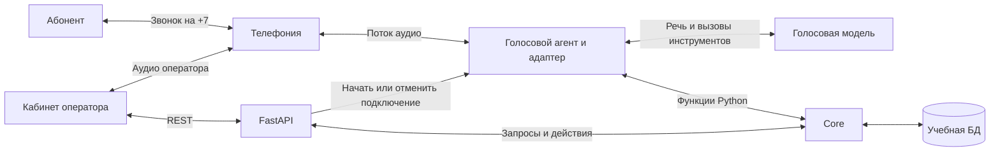
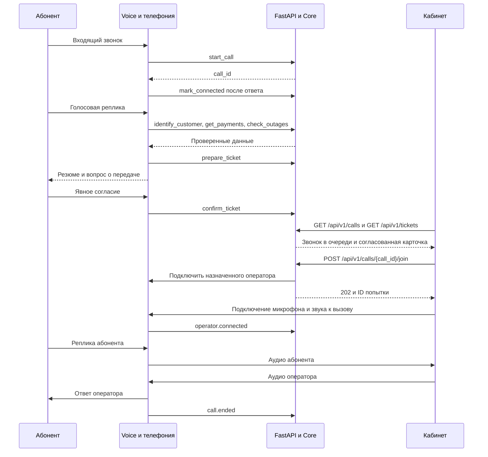

# Архитектура IRIS

**SkyNet Signal · Задача № 1 · Контракт для разработки**

IRIS принимает звонок на +7, уточняет запрос и проверяет данные учебного абонента. После согласия абонента агент передаёт карточку в нужный отдел. Оператор подключается из браузера и продолжает тот же разговор. Ниже описано целевое поведение проекта.

## Блоки проекта

| Папка | Ответственность |
| --- | --- |
| `voice/` | Приём вызова и аудио через адаптер телефонии, распознавание и синтез речи, диалог, вызовы Core, переключение аудио на оператора. |
| `backend/` | FastAPI, правила Core, проверка абонента, учебная база, звонки, обращения, очереди и резервирование звонка. |
| `frontend/` | Список звонков и очередь отдела, карточка обращения, транскрипция и подключение микрофона оператора. |

Для первого прототипа Voice и Core работают в одном Python-приложении и вызывают друг друга через функции. Core читает и записывает данные в SQLite. Кабинет получает данные по HTTP, а аудио передаётся через адаптер телефонии. Провайдер номера, голосовая модель и способ подключения браузерного аудио определяются при интеграции.



## Как проходит звонок

1. **Входящий вызов.** Адаптер получает событие и вызывает `start_call`. Core создаёт запись `ringing` и возвращает `call_id`. Повтор с тем же внешним ID возвращает ту же запись. После ответа статус становится `active`, этап — `ai_active`. Один `call_id` связывает аудио, контекст, реплики и обращение.
2. **Проверка абонента.** Номер звонящего помогает найти профиль. В учебном сценарии агент сверяет номер договора и квартиру, а при нескольких договорах уточняет нужный адрес услуги. Core проверяет принадлежность договора в каждом запросе. Новый абонент может оставить запрос на подключение по названному адресу без договора.
3. **Уточнение запроса.** Агент выясняет, какого результата ждёт абонент. Если вопросов несколько, просит выбрать первый и сохраняет остальные в карточке. По договору проверяет тариф, баланс и статус платежа, по адресу услуги — аварии. При недоступности источника сообщает, что проверку выполнить не удалось. Отсутствие записи об аварии означает, что по этому адресу в базе нет известных активных инцидентов.
4. **Выбор отдела.** Проблема с зачислением или списанием идёт в `billing`, неисправность связи — в `technical_support`, новая услуга — в `connection`. Если оплата зачислена, а связи по-прежнему нет, агент выясняет, какие устройства затронуты, и предлагает поддержку.
5. **Согласие и очередь.** Агент сохраняет черновик, зачитывает резюме и спрашивает согласие на передачу. Поправка создаёт новую версию. Core сверяет, что финальная реплика с согласием относится к звонку и прозвучала после озвучивания актуальной версии. Смысл ответа определяет агент. После согласия Core одной транзакцией создаёт обращение, ставит звонок в `waiting_for_operator` и записывает итог `ticket_created`. Повтор подтверждения возвращает то же обращение.
6. **Подключение оператора.** Кабинет получает список звонков по HTTP. Оператор открывает карточку и вызывает `POST /api/v1/calls/{call_id}/join`. Core проверяет отдел, живой вызов и текущий резерв, затем закрепляет звонок за оператором. Адаптер подключает его к текущему вызову. Когда аудио оператора готово, адаптер соединяет абонента с оператором, останавливает воспроизведение ИИ и сообщает Core об успешном подключении. Этап становится `with_operator`.
7. **Завершение и ошибки.** При отказе микрофона или истечении резерва адаптер закрывает попытку подключения и возвращает живой звонок в очередь. При отключении оператора абонент остаётся на линии и звонок снова доступен отделу. Когда абонент завершает вызов, адаптер закрывает медиа и фиксирует итог. Если согласие уже было, обращение остаётся у отдела. При сбое модели адаптер переводит звонок в резервную очередь, если она настроена. Иначе воспроизводит сообщение о недоступности и завершает вызов.



## HTTP API

Все маршруты кабинета под `/api/v1` используют `Authorization: Bearer <operator_token>`. Для демо у каждого учебного оператора заранее выдан токен. Сервер определяет его роль и отделы. До назначения отдела кабинет может показывать технический статус входящего звонка и маскированный номер. Карточка, очередь и реплики доступны сотрудникам назначенного отдела. Раздел с профилями учебных клиентов доступен руководителю.

| Метод и маршрут | Кто вызывает и что передаёт | Успешный ответ |
| --- | --- | --- |
| `GET /health` | Разработчик или проверка доступности. | `200 {"status":"ok"}` или `503`, если база недоступна. |
| `GET /docs` | Разработчик в среде разработки. | `200`, Swagger UI. |
| `GET /openapi.json` | Разработчик или генератор типов. | `200`, схема реализованных HTTP-маршрутов. |
| `GET /api/v1/me` | Кабинет при открытии. | `200`, `id`, `name`, `role` и `departments[]`. |
| `GET /api/v1/dashboard` | Кабинет сводки. Фильтры `from`, `to`, `department`. | `200`, `calls_total`, `calls_active`, `tickets_total` и `average_duration_seconds`. |
| `GET /api/v1/calls` | Список. Фильтры `status`, `phase`, `outcome`, `department`, `from`, `to`. | `200 Page<CallSummary>`. |
| `GET /api/v1/calls/{call_id}` | Открытие карточки или проверка состояния подключения. | `200 CallDetail`. |
| `GET /api/v1/calls/{call_id}/messages` | Вкладка транскрипции. | `200 Page<CallMessage>` по возрастанию `sequence`. |
| `POST /api/v1/calls/{call_id}/join` | Кнопка «Подключиться». Оператор определяется по токену, запрос без тела. | `202` с `call_id`, `attempt_id`, `phase: operator_joining` и `expires_at`. Кабинет ждёт соединения через адаптер аудио. |
| `GET /api/v1/customers` | Экран учебных клиентов. Поиск `q` по имени или договору. | `200 Page<CustomerSummary>`, где клиент содержит `id`, `name` и `phone_masked`. |
| `GET /api/v1/customers/{customer_id}` | Профиль клиента. | `200`, данные профиля и `accounts[]` с адресом, тарифом, балансом и статусом. |
| `GET /api/v1/tickets` | Очередь отдела. Фильтры `department`, `status`, `call_id`. | `200 Page<Ticket>`. |
| `GET /api/v1/tickets/{ticket_id}` | Открытие согласованной карточки. | `200 Ticket`. |
| `PATCH /api/v1/tickets/{ticket_id}` | Оператор берёт обращение в работу или завершает её. Тело `{"status":"in_progress"}` или `{"status":"closed"}`. | `200 Ticket`. Бэкенд проверяет текущий статус и ответственного. |
| `GET /api/v1/events` | Кабинет при включении SSE. При переподключении передаёт `Last-Event-ID`. | `200 text/event-stream` для доступных звонков и обращений. |

`Page<T>` содержит `items[]`, `total`, `limit` и `offset`. По умолчанию `limit=50`, `offset=0`, максимум `limit=100`. Списки отсортированы от новых к старым по времени создания и ID. Фильтры необязательные, `from` включительно, `to` исключительно. ID передаются строками, даты в ISO 8601 с часовым поясом, суммы в целых копейках.

| Тип | Основные поля |
| --- | --- |
| `CallSummary` | `id`, `caller_phone_masked`, `status`, `phase`, `outcome`, `department`, `started_at`, `connected_at`, `ended_at`, `duration_seconds`. |
| `CallDetail` | Поля `CallSummary`, а также `customer_id`, `account_id`, `ticket_id`, `end_reason` и `can_join`. `ticket_id` появляется после согласия. |
| `CallMessage` | `id`, `call_id`, `sequence`, `role` (`customer`, `assistant` или `operator`), `text`, `interrupted` и `created_at`. |
| `Ticket` | `id`, `call_id`, `account_id`, `department`, `status`, `operator_id`, `customer_request`, `customer_report`, `summary`, `verified_facts[]`, `open_question`, `secondary_questions[]`, `confirmed_at` и `updated_at`. |
| `VerifiedFact` | `source`, `reference_id`, `text` и `checked_at`. Источники — `accounts`, `payments`, `incidents`. |

Неизвестные или ещё неприменимые значения передаются как `null`. Ошибка возвращается в формате `{"error":{"code":"call_unavailable","message":"Звонок уже принят"}}`. `401` — недействительный токен, `403` — действие запрещено роли, `404` — запись недоступна или отсутствует, `409` — конфликт состояния, `422` — некорректные параметры. При подтверждённой недоступности телефонии `join` возвращает `503` и освобождает резерв.

Резерв на подключение действует 30 секунд. Повтор запроса тем же оператором в этот срок возвращает тот же `attempt_id`. Второй оператор получает `409`. Адаптер проверяет срок резерва, связывает приглашение с `call_id` и `attempt_id` и закрывает просроченную попытку. Приглашение может прийти раньше ответа `202`, поэтому кабинет сопоставляет оба сообщения перед запуском аудио. Запоздалый результат старой попытки не меняет статус звонка. Кабинет читает `GET /api/v1/calls/{call_id}` до перехода в `with_operator`, возврата в очередь или завершения звонка.

В основном демо `GET /api/v1/calls?phase=waiting_for_operator&department=technical_support` возвращает звонок `call_1042`. Кабинет получает `ticket_id` из карточки звонка и открывает `GET /api/v1/tickets/{ticket_id}`. После нажатия «Подключиться» он получает следующий ответ.

```json
{
  "call_id": "call_1042",
  "attempt_id": "attempt_01",
  "phase": "operator_joining",
  "expires_at": "2026-11-27T11:32:30Z"
}
```

Для первого запуска кабинет опрашивает список и открытую карточку каждые две секунды. SSE подключается после первичной загрузки REST и уведомляет об изменениях. События `call.updated`, `call.ended`, `ticket.created` и `ticket.updated` содержат `call_id` и, где применимо, `ticket_id`. Событие `call.transcript` содержит `CallMessage`. Записи публикуются после сохранения в БД. При переподключении сервер отдаёт доступные события после `Last-Event-ID`. Если события больше недоступны, кабинет заново читает состояние через REST. Для SSE с bearer-токеном кабинет открывает поток через `fetch`.

## Контракт Voice и Core

| Функция Core | Вход и результат |
| --- | --- |
| `start_call` | Внешний ID и номер звонящего → `call_id` и исходный статус. |
| `mark_connected` | `call_id` и время ответа → активный вызов. |
| `identify_customer` | `call_id`, договор и квартира → результат учебной проверки. |
| `get_accounts` | `call_id` → доступные договоры абонента. |
| `get_account_details` | `call_id` и `account_id` → адрес, тариф, баланс и статус услуги. |
| `get_payments` | `call_id` и `account_id` → сумма, статус и время платежей. |
| `check_outages` | `call_id` и `account_id` → известные инциденты по адресу договора. |
| `get_previous_tickets` | `call_id` и `account_id` → доступная история обращений. |
| `append_message` | `call_id`, ID события и финальная реплика → запись транскрипции. |
| `prepare_ticket` | `call_id` и содержание карточки → `draft_id` и `version`. |
| `confirm_ticket` | `call_id`, `draft_id`, `version` и `confirmation_message_id` → подтверждённое обращение. |
| `finish_call` | `call_id`, время, конечный статус и причина → финальная карточка звонка. |

Voice подставляет `call_id` из текущей сессии. Модель вызывает инструменты работы с профилем и обращением, а Voice регистрирует события транспорта и сохраняет реплики. При перебивании Voice прерывает генерацию и очищает невоспроизведённый звук. При передаче оператору сессия модели закрывается, а телефонное соединение продолжает работать.

Команда из FastAPI в адаптер содержит `call_id`, `attempt_id`, ID оператора и `expires_at`. Адаптер возвращает события `operator.connected`, `operator.failed`, `operator.disconnected` и `call.ended`. Событие содержит уникальный `event_id`, `call_id`, время и `attempt_id` для событий подключения. Core обрабатывает дубли идемпотентно. Внешние URL вебхуков, кодек и способ авторизации транспорта определяются после выбора телефонии. Внутри проекта адаптер передаёт результат в Core вызовом Python.

## Состояния и хранение данных

| Поле | Значения |
| --- | --- |
| Технический статус звонка | `ringing → active → completed / abandoned / failed`. Из `ringing` возможны `abandoned` и `failed`. Финальное состояние не перезаписывается поздним событием. |
| Этап активного звонка | `ai_active → waiting_for_operator → operator_joining → with_operator`. После неудачного подключения этап снова `waiting_for_operator`. До ответа и после завершения этап равен `null`. |
| Итог звонка | `unknown`, `answered`, `ticket_created`, `unresolved`, `no_confirmation`. После сохранения обращения итог `ticket_created` сохраняется даже при разрыве связи. |
| Статус обращения | `queued → in_progress → closed`. При потере оператора в активном звонке незакрытое обращение возвращается в очередь. |
| Отдел | `technical_support`, `billing`, `connection`. |

Учебная БД хранит клиентов, договоры, адреса, тарифы, платежи и инциденты. У клиента может быть несколько договоров, платёж связан с договором, авария — с адресом услуги. Запись звонка связывает внешний ID вызова, профиль, транскрипцию и операторское назначение. Обращение хранит исходную просьбу, согласованное резюме, снимок проверенных фактов и ссылку на реплику с согласием. Для демо на звонок создаётся одно подтверждённое обращение.

## Демо и пилот

Проверяем входящий вызов на +7, зачисленный платёж и аварию по адресу, поправку к резюме, появление карточки после согласия и двусторонний звук после подключения оператора. Отдельно прогоняем два одновременных нажатия «Подключиться» и разрыв связи до и после согласия.

Ориентир пилота — 1000 звонков в сутки. При средней длительности 4 минуты и 200–300 звонках в пиковый час это в среднем 13–20 занятых линий за этот час. Стартовая оценка для проверки — 30 одновременных входящих линий. Фактическую ёмкость и квоту голосовых сессий определяем по пику из журнала звонков и нагрузочному тесту.
