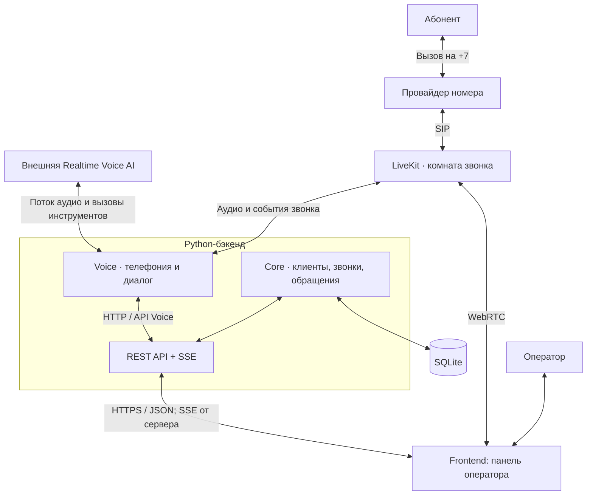
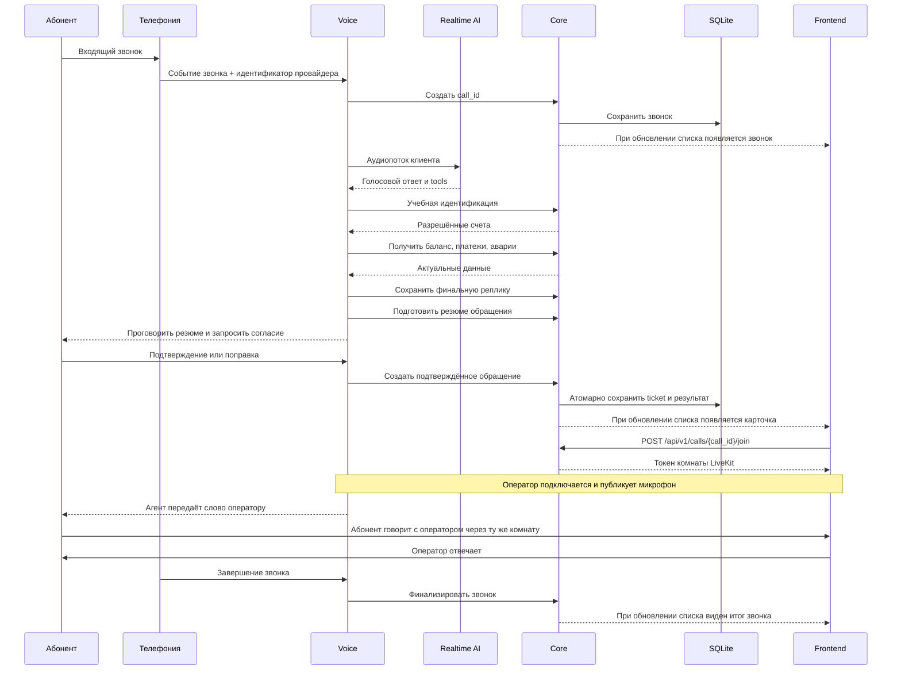
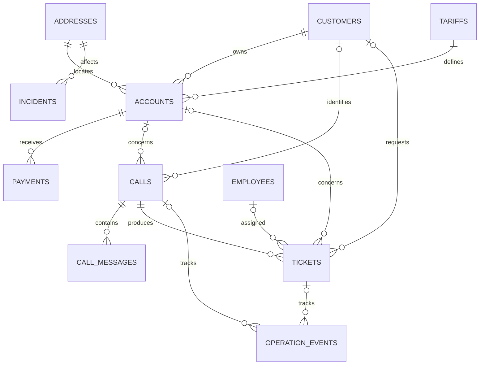

# IRIS — архитектура голосовой приёмной SkyNet

**SkyNet Signal · Кейс № 1 · Версия 1.1**

## Кабинеты V3

Один frontend использует общую светлую оболочку для двух рабочих пространств. Роль в серверной сессии определяет доступ к маршрутам руководителя или к назначенным рабочим данным оператора. Оба кабинета используют существующую схему CRM. FastAPI предоставляет сессионный API V3 и отдельный сервисный контракт Contact Center и Voice.

- [Границы модулей](MODULE_BOUNDARIES.md)
- [Модель данных](DATA_MODEL.md)
- [Роли и разрешения](ROLE_PERMISSIONS.md)
- [CRM](CRM_MODULE.md)
- [Кабинет оператора](OPERATOR_WORKSPACE.md)
- [Кабинет руководителя](MANAGEMENT_CENTER.md)
- [Дизайн-система](DESIGN_SYSTEM.md)
- [Состояние проекта](PROJECT_STATUS.md)

## 1. Цель продукта

IRIS — голосовой ИИ-помощник интернет-провайдера. Абонент звонит на обычный телефонный номер, объясняет проблему своими словами, а агент уточняет потребность, при необходимости получает данные учебного абонента из базы, согласовывает резюме и передаёт обращение в очередь нужного специалиста. Оператор видит звонки, транскрипции и результаты в веб-интерфейсе.

Основной результат кейса: оператор может продолжить работу с последнего уточнения, не заставляя клиента повторять рассказ. В демо IRIS оператор нажимает «Подключиться» и продолжает тот же звонок. Если абонент уже положил трубку, карточка остаётся в очереди отдела.

## 2. Архитектурное решение

**Один Backend (модульный монолит), один Frontend, одна база данных, один репозиторий.**

CRM и Contact Center Core работают в одном FastAPI и используют один файл SQLite. FastAPI обслуживает кабинеты через REST и SSE. Для будущего процесса Voice предусмотрен HTTP-контракт. Voice будет передавать события звонков в FastAPI и управлять медиапотоками через LiveKit. [Контракт Voice](VOICE_CORE_INTEGRATION.md)



- Core — единственный владелец бизнес-данных и правил их изменения.
- Voice не пишет SQL и не обращается к базе в обход Core.
- Frontend запрашивает карточку и токен у Backend. Звук передаётся через LiveKit JS SDK.
- Голосовая модель не имеет прямого доступа к базе, секретам или административному API.
- Данные звонка привязываются к его `call_id`, а не к глобальному состоянию агента.

## 3. Технологический стек

| Слой | Выбор |
|---|---|
| Backend | Python 3.11+ / FastAPI / Uvicorn / Pydantic |
| Голос | Realtime Voice API; поставщик выбирается после проверки русского языка, аудио и function calling |
| Телефония | Российский +7 с переадресацией на SIP URI проекта LiveKit Cloud |
| Связь аудио | LiveKit Agents для Voice и WebRTC для браузера оператора |
| База | SQLite / SQLAlchemy |
| Frontend | React + TypeScript + Vite + Tailwind CSS |
| API | REST / JSON, OpenAPI (`/docs`, `/openapi.json`) |
| Live-обновления | SSE из SQLite. При обрыве кабинет обновляет REST каждые 5 секунд |
| Развёртывание | FastAPI хранит данные в SQLite и предоставляет HTTP API отдельному процессу Voice |
| Контроль версий | GitHub, монорепозиторий |

## 4. Ответственность модулей

| Зона | Модуль | Ответственность |
|---|---|---|
| Voice AI | `voice/` | Настоящий входящий звонок, естественная речь, перебивания, контекст, вызовы Core, передача реплик и завершение звонка |
| Core / Backend | `backend/app/core/`, `backend/app/api/`, `backend/app/database.py` | Учебная база, идентификация, бизнес-логика, хранение звонков, обращения, REST API, SSE |
| Frontend | `frontend/` | Список и карточки звонков, live-транскрипция, карточки клиентов, очередь специалистов, отображение ошибок и статусов |

Совместная ответственность: согласование контрактов, сквозные тесты, развёртывание, README, видео и защита. Изменения общих типов и статусов согласовываем прежде, чем менять код. Core-разработчик владеет миграциями базы; участники не редактируют одну SQLite-базу на разных компьютерах через Git.

## 5. Структура репозитория

- `backend/app/` содержит FastAPI, CRM, Contact Center Core, авторизацию и подключение SQLite. Команда миграции и синтетические данные описаны в модели данных. [Модель данных](DATA_MODEL.md)
- `frontend/` содержит React-приложение и Playwright-сценарии для обоих кабинетов.
- `contracts/` содержит OpenAPI и учебные примеры запросов и ответов.
- `voice/` выделен для сервиса телефонии. [Контракт Voice AI](VOICE_CORE_INTEGRATION.md)

## 6. Жизненный цикл звонка



Если клиент задаёт два вопроса, агент уточняет, какой важнее, и фиксирует второй как открытый вопрос. При изменении адреса, темы или резюме ранее полученное подтверждение сбрасывается. Если клиент завершил звонок до подтверждения, обращение не создаётся автоматически. Технический сбой фиксируется отдельно от результата консультации. Уже сохранённое обращение не теряется при разрыве связи.

### Подключение оператора

До интеграции Voice оператор видит состояние аудио в кабинете. API отдаёт `can_join: false`, а маршрут подключения возвращает `501`.

В целевом сценарии у каждого вызова отдельная комната LiveKit. FastAPI проверяет оператора и его отдел, атомарно резервирует звонок на 30 секунд и возвращает `server_url`, `participant_token` и `expires_at`. Повтор из того же кабинета в пределах резерва использует то же назначение. Другой оператор получает `409`.

Кабинет подключается и публикует микрофон. Voice сверяет участника с назначением в Core, прекращает ответ и отключает свои аудиодорожки после появления дорожки оператора. Если резерв истекает раньше, Core освобождает звонок, а просроченный участник удаляется из комнаты. При завершении звонка подтверждённая карточка остаётся у отдела. [Входящая телефония](https://docs.livekit.io/telephony/accepting-calls/workflow-setup/) · [Токены LiveKit](https://docs.livekit.io/frontends/reference/tokens-grants/)

## 7. Модель данных

FastAPI создаёт таблицы SQLAlchemy при запуске. С `IRIS_DEMO=1` Core добавляет синтетические записи из модулей `crm_seed.py` и `operations_seed.py`. История включает завершённый учебный звонок `call_1042` со сводкой из примера контракта и открытым обращением `T-1042`. Повторный запуск сохраняет изменения оператора.

| Таблица | Назначение |
|---|---|
| `customers` | ID, ФИО, учебный телефон |
| `accounts` | Лицевой счёт, клиент, адрес, квартира, тариф, баланс, статус услуги, роутер |
| `addresses` | Город, улица, дом, корпус |
| `tariffs` | Название, скорость, абонентская плата |
| `payments` | Сумма, статус, дата оплаты и зачисления |
| `incidents` | Авария по адресу, описание, статус, прогноз восстановления |
| `calls` | Время поступления, ответа и завершения, клиент, счёт, статус, фаза, итог, отдел, сводка и время её проверки |
| `call_messages` | Реплики клиента и агента |
| `call_message_sources` | Идентификаторы сообщений провайдера для повторной доставки |
| `tickets` | Обращение, звонок, отдел, сводка, времена обработки, статус, приоритет и назначенный сотрудник |
| `handoff_confirmations` | Связь звонка, реплики согласия и обращения |
| `employees` | Имена, отделы и статусы доступности сотрудников |
| `operation_events` | Журнал изменений для истории и SSE |



### Расширения базы для интеграции Voice

- Сохранить `provider_call_id`, время верификации, причину завершения, имя комнаты, назначенного оператора, ID участника текущей попытки и срок резерва.
- Для реплик Voice уточнить порядок и обработку прерываний с выбранным провайдером. Core сохраняет финальные реплики в порядке поступления и учитывает идентификатор события.
- При расширении передачи в очередь за пределы одного обращения на звонок потребуется хранить версии черновиков.
- При необходимости: таблица черновиков обращения с версией и временем подтверждения.

Суммы хранятся целыми числами в копейках. Клиенты, счета, звонки и обращения имеют строковые ID. В публичном API даты передаются в ISO 8601 с часовым поясом, кабинет показывает их по МСК. SQLite включает внешние ключи для каждого соединения и использует WAL для файловой базы. Внешние AI-запросы следует выполнять вне транзакций SQLite.

Учебные тарифы существующих абонентов не являются реальными предложениями SkyNet. Сведения о публичных услугах и акциях брать с официального сайта, сохранять ссылки и дату просмотра. Адреса, счета и платежи — исключительно синтетические.

## 8. Внутренний контракт Voice ↔ Core

Модуль `app.core.call_ingest` принимает события через синхронные функции Python. Асинхронный Voice вызывает их в пуле потоков. FastAPI и Voice используют один `DATABASE_PATH`. Перед обработкой событий Core инициализирует таблицы через `app.database.init_database()`.

```python
start_call(provider_call_id: str, caller_phone: str | None = None) -> Call
mark_connected(call_id: str) -> Call
identify_customer(call_id: str, account_id: str, apartment: str) -> bool
get_account_details(call_id: str) -> AccountDetail
append_message(call_id: str, message: MessageInput) -> CallMessage
confirm_ticket(
    call_id: str,
    handoff: Handoff,
    confirmation_message_id: int,
    department: Department,
    account_number: str | None = None,
) -> Ticket
finish_call(call_id: str, status: CallStatus, outcome: CallOutcome) -> Call
```

Voice передаёт стабильный идентификатор вызова, уникальный для провайдера или транка. Core создаёт состояние `ringing`. `mark_connected` переводит звонок в `active` и `ai_active`. Повтор события возвращает сохранённую запись.

- `identify_customer` сверяет учебный счёт и квартиру, привязывает счёт к активному звонку. После идентификации другой договор должен принадлежать тому же клиенту. Для абонента без идентификации можно сохранить обращение без счёта.
- `get_account_details` возвращает данные текущего подтверждённого счёта из CRM, в том числе тариф, баланс, оборудование, платежи и активные инциденты по адресу. До идентификации и после завершения звонка Core возвращает конфликт.
- `MessageInput` содержит стабильный `event_id` в рамках звонка, `speaker` со значением `customer`, `assistant` или `operator`, текст и необязательное `created_at` с часовым поясом. `append_message` возвращает `id` сохранённой реплики. Повтор события возвращает тот же ID, повтор с другим содержимым вызывает конфликт.
- Voice хранит актуальную версию черновика и вызывает `confirm_ticket` после явного согласия абонента. Core проверяет, что указанная реплика принадлежит клиенту текущего звонка, и присваивает сводке время этой реплики. В одной транзакции Core создаёт обращение, переводит разговор в `waiting_for_operator` и сохраняет событие. Повтор того же подтверждения возвращает существующее обращение. Учебный сценарий поддерживает одно голосовое обращение на звонок.
- `finish_call` принимает `completed`, `abandoned` или `failed`. Из `ringing` можно перейти в `abandoned` или `failed`. Повтор или запоздалое событие сохраняет финальное состояние. При существующем обращении итог `ticket_created` сохраняется даже при обрыве связи.

Перед подключением полноценного диалога следует связать чтение предыдущих обращений с подтверждённым контекстом звонка. При смене темы, адреса или резюме Voice запрашивает согласие на обновлённую версию.

Пример черновика `TicketDraft`:

```json
{
  "account_id": "100042",
  "department": "technical_support",
  "customer_request": "Восстановить интернет после оплаты",
  "summary": "Платёж зачислен; связи нет на всех устройствах; зарегистрирована авария NET-102.",
  "facts": [
    {"source": "customer", "text": "Интернет не работает на всех устройствах"},
    {"source": "database", "text": "Платёж P1 зачислен", "ref": "P1"},
    {"source": "database", "text": "Авария NET-102 открыта", "ref": "NET-102"}
  ],
  "open_question": "Уточнить состояние линии и сообщить клиенту дальнейшие действия",
  "secondary_questions": ["Подключение интернета по адресу матери"]
}
```

При неизвестном адресе или неподтверждённой личности в обращении указываются только сведения, предоставленные самим собеседником, без раскрытия данных другого клиента. В заявке на подключение `account_id` может быть `null`.

## 9. HTTP API для Frontend

Маршруты кабинета используют префикс `/api/v1`. У звонков и обращений порядок по умолчанию от новых записей к старым, `limit` равен 50, `offset` равен 0. Схемы публикует FastAPI. [OpenAPI](../contracts/openapi.json)

| Метод | Путь | Результат |
|---|---|---|
| GET | `/health` | Готовность Backend и базы |
| GET | `/api/v1/dashboard` | Число всех, активных, завершённых звонков и обращений, средняя длительность, обращения по отделам, последние звонки и активные инциденты |
| GET | `/api/v1/analytics` | Сотрудники онлайн, среднее ожидание и нагрузка по отделам |
| GET | `/api/v1/calls` | Звонки, фильтры `status`, `outcome`, `department`, `customer_id`, `account_number`, `live`, `limit`, `offset` |
| GET | `/api/v1/calls/{call_id}` | Карточка звонка, итог, реплики, журнал событий и связанные обращения |
| POST | `/api/v1/calls/{call_id}/join` | Запрос подключения. До интеграции Voice возвращает `501` |
| POST | `/api/v1/calls/{call_id}/confirm-summary` | Фиксирует проверку итоговой сводки оператором |
| GET | `/api/v1/calls/{call_id}/messages` | Транскрипция в порядке реплик |
| GET | `/api/v1/customers` | Клиенты, поиск по ФИО, номеру телефона и лицевому счёту |
| GET | `/api/v1/customers/{customer_id}` | Клиент и его счета |
| GET | `/api/v1/tickets` | Очередь, фильтры `department`, `status`, `priority`, `customer_id`, `account_number`, `limit`, `offset`. `sort=queue` сортирует по статусу, приоритету и времени ожидания |
| GET | `/api/v1/tickets/{ticket_id}` | Карточка обращения |
| PATCH | `/api/v1/tickets/{ticket_id}` | Начало обработки, закрытие или перенаправление в другой отдел |
| GET | `/api/v1/employees` | Сотрудники, их отделы и статусы доступности |
| PATCH | `/api/v1/employees/{employee_id}` | Смена статуса сотрудника |
| GET | `/api/v1/events` | SSE-поток изменений для панели |

При `live=true` список включает звонящие и активные вызовы. Показатель активных звонков в обзоре считает статус `active`. Средняя длительность рассчитывается по звонкам с зарегистрированным ответом и завершением. Обзор и карточки читают текущую базу. Запуск с `IRIS_DEMO=1` добавляет учебные записи.

Пагинированные списки возвращают `items`, `total`, `limit` и `offset`. Ошибки возвращаются в формате FastAPI через поле `detail`. Отсутствующая запись даёт `404`, конфликт состояния даёт `409`, ошибка валидации даёт `422`.

При начале обработки обращение переходит из `queued` в `in_progress` и назначается текущему сотруднику учебного кабинета. Закрыть можно обращение в работе. При переводе в другой отдел обращение возвращается в `queued`, отсчёт ожидания начинается заново, назначение снимается. Повтор запроса с уже установленным статусом или отделом возвращает текущую запись. Подтверждение оператором сохраняет время проверки сводки отдельно от согласия абонента.

Телефонные webhooks и WebSocket обслуживает Voice внутри того же приложения. Их пути и схема зависят от выбранного провайдера. Voice вызывает Core через Python.

## 10. События и live-обновления

Core сохраняет изменения вместе с записью в `operation_events` в одной транзакции. SSE отправляет уведомление, а запись целиком кабинет перечитывает через REST. После переподключения API воспроизводит события после `Last-Event-ID`. Без SSE кабинет обновляет данные каждые 5 секунд.

| Событие | Назначение |
|---|---|
| `ticket.updated` | Оператор начал обработку, закрыл или перенаправил обращение |
| `call.summary_reviewed` | Оператор проверил итоговую сводку |
| `employee.updated` | Изменился статус доступности сотрудника |
| `call.started`, `call.connected`, `call.identified`, `call.transcript`, `ticket.created`, `call.ended` | Core сохранил состояние звонка, реплику или подтверждённое обращение |

Поток передаёт `event: change` и числовой `id` из общего журнала. Поле `resources` сообщает, какие данные перечитать. `call_id` и `ticket_id` могут иметь значение `null`.

```text
id: 42
event: change
data: {"resources":["tickets","calls","dashboard"],"type":"ticket.updated","call_id":"call_1042","ticket_id":"T-1042"}
```

Core публикует финальные реплики и изменения звонков через журнал с ресурсом `calls`. При перебивании Voice передаёт произнесённую часть реплики. После завершения аудио Voice вызывает финализацию звонка, в том числе после обрыва связи.

## 11. Единые статусы

### `CallStatus` — техническое состояние звонка

- `ringing` — поступил, ожидает ответа.
- `active` — соединение установлено.
- `completed` — разговор завершён штатно.
- `abandoned` — звонок прерван клиентом до результата.
- `failed` — техническая ошибка.

Переходы: `ringing -> active -> completed | abandoned | failed`; из `ringing` возможны `abandoned` и `failed`. Финальное состояние не перезаписывается запоздавшим событием. `end_reason` хранит причину завершения.

### `CallPhase` — этап активного звонка

`ai_active → waiting_for_operator → operator_joining → with_operator`. Если резерв истекает, звонок возвращается в `waiting_for_operator`. После завершения соединения `phase` становится `null`. Карточка может оставаться в очереди после завершения разговора.

### `CallOutcome` — бизнес-результат

- `unknown` — ещё не определён.
- `answered` — предоставлена информация (не обязательно проблема устранена).
- `ticket_created` — обращение успешно сохранено.
- `unresolved` — вопрос остался открытым.
- `no_confirmation` — клиент не подтвердил передачу обращения.

### `TicketStatus` — состояние работы специалиста

- `queued` — ожидает специалиста.
- `in_progress` — в работе.
- `closed` — закрыто специалистом.

### `Department` — направление обращения

- `technical_support` — техническая поддержка.
- `billing` — платежи и расчёты.
- `connection` — новые подключения.

Например: `call.status = completed`, `call.outcome = ticket_created`, `ticket.status = queued`. Это значит, что звонок завершён и заявка передана, но проблема ещё не решена. Если связь оборвалась после сохранения обращения, итог `ticket_created` сохраняется независимо от технического статуса. `ticket_created` устанавливается Core только при фактически существующей записи в базе.

## 12. Voice: требования к живому диалогу

- Естественный русский голос, короткие реплики, спокойная манера общения без жёсткого меню; агент представляется как ИИ.
- Потоковая передача аудио в обе стороны; определение конца реплики (VAD/turn detection) и перебивание (barge-in).
- При перебивании отменить генерацию ответа и очистить буфер ещё не воспроизведённого аудио; учитывать реально услышанный клиентом контекст, если провайдер это поддерживает.
- Отдельная сессия модели и контекст для каждого звонка; при завершении освобождать соединения и ресурсы.
- Вызовы tools асинхронны, ограничены тайм-аутами; при ошибке сообщать, что сведения недоступны, не выдумывать баланс, наличие аварии или срок восстановления.
- Данные из базы отличать от слов клиента и от предположений агента. Отсутствие известной аварии не доказывает исправность интернета у абонента.
- Агент не обещает исправить интернет и не заявляет об успешной передаче, пока Core не вернул сохранённый `ticket_id`.
- В MVP не принимаем оплату, не меняем тарифы, не выполняем произвольные административные действия.

Для проверки Voice до активации номера можно войти в ту же комнату из браузера и использовать заглушку Core. Приёмочный сценарий телефонии начинается с вызова на +7.

## 13. Frontend: рабочее место оператора

| Экран | Обязательное содержимое |
|---|---|
| Звонки | Время, номер (маскированный при необходимости), клиент, длительность, технический статус, результат, отдел |
| Карточка звонка | Транскрипция, сводка, факты клиента и базы, открытый вопрос, согласие, связанные обращения |
| Очередь | Фильтры по трём отделам, карточка обращения, переход `queued -> in_progress -> closed` |
| Клиенты | Учебные профили, счета, адреса, баланс, тариф, платежи, известные аварии |
| Обзор (если успеваем) | Количество звонков, активных, завершённых, обращения по отделам, средняя длительность |

Главный экран для демо — карточка с подтверждённым резюме и кнопкой «Подключиться». При `can_join: true` кабинет позволяет оператору взять звонок. Оператор видит проверенные факты и открытый вопрос, затем продолжает разговор по WebRTC. Транскрипцию можно добавить после проверки звонка.

## 14. Конфигурация и запуск

`IRIS_DEMO=1` включает синтетические данные, а `DATABASE_PATH` задаёт файл SQLite для FastAPI. `IRIS_VOICE_TOKEN` нужен для сервисных запросов между Voice и Core. SIP и LiveKit настраиваются в процессе Voice. [Запуск](../README.md#запуск-демо) · [Подключение Voice](VOICE_CORE_INTEGRATION.md)

## 15. Приёмочные сценарии

Учебные счета для проверки CRM и будущей голосовой интеграции.

| Счёт | Данные | Ожидаемое поведение |
|---|---|---|
| 100042 | +450 ₽, платёж зачислен, авария NET-102 | Уточнить устройства, указать известную аварию, передать в техническую поддержку после согласия |
| 100043 | −500 ₽, платёж неуспешен | Выяснить обстоятельства, предложить передачу в отдел платежей |
| 100044 | −1000 ₽, платёж в обработке | Не утверждать, что платёж зачислен; направить в отдел платежей |
| 100045 | +900 ₽, известных открытых аварий нет | Уточнить характер проблемы, не объявлять линию исправной без диагностики |
| 100046 / 100047 | Два счёта одного клиента | Уточнить, какой адрес обсуждается, не смешивать данные |
| Неизвестный клиент | Нет счёта в базе | Не раскрывать данные других людей; оформить запрос на подключение при согласии |

Обязательные негативные тесты: клиент меняет приоритет между двумя вопросами; исправляет резюме после озвучивания; не даёт согласия; кладёт трубку до/после согласия; инструмент возвращает ошибку; повторное событие не создаёт дубликат; одновременно идут два звонка; UI переподключается и получает актуальное состояние.

### Definition of Done

- [ ] Входящий звонок на +7 работает от начала до конца.
- [ ] ИИ разговаривает в свободной форме, уточняет намерение и учитывает поправки.
- [ ] Проверка баланса, платежей и аварий выполняется через Core на учебной базе.
- [ ] Клиент слышит резюме и явно соглашается; только после этого создаётся обращение в правильном отделе.
- [ ] В обращении есть просьба клиента, выясненные факты, открытый вопрос и след подтверждения.
- [x] Frontend показывает историю, статус и карточку обращения. Список обновляется через SSE с резервным обновлением через REST.
- [ ] Оператор подключается из кабинета. Абонент и оператор слышат друг друга, агент освобождает аудио.
- [ ] При сбое сохраняется корректный статус, а агент не выдумывает результат.
- [ ] Открытый репозиторий, README, seed и инструкции позволяют повторить основной сценарий.

## 16. Приоритеты и порядок работы

| Приоритет | Содержание |
|---|---|
| P0 | Входящий вызов на +7, разговор с ИИ, проверка учебных данных, согласование карточки, очередь и подключение оператора к тому же звонку |
| P1 | Перебивания, живая транскрипция, несколько параллельных звонков |
| P2 | Запись аудио, аналитика качества, мобильное приложение |

Первый технический рубеж — позвонить с мобильного и услышать приветствие IRIS. Следом проверить двусторонний звук между абонентом и браузером оператора. Затем добавить голосовую модель и инструменты Core.

Порядок интеграции:

1. Voice подключает номер и проверяет приветствие. Frontend собирает список и карточку на учебном API. Core реализует чтение договоров, платежей и инцидентов.
2. Voice и Frontend проверяют подключение оператора к комнате входящего звонка.
3. Voice и Core связывают голосовую модель с инструментами и подтверждением обращения.
4. Команда проверяет сквозной сценарий, истечение резерва и разрыв связи перед записью демо.

Целевой рубеж: работающий сквозной сценарий вечером 27 ноября, стабилизация и запись видео 28 ноября. Время сдачи по памятке — **29 ноября до 10:00 МСК**. Защита — **29 ноября в 12:00 МСК**, 3 минуты вместе с видео и 3 минуты на вопросы. Презентация по структуре шаблона и отдельное видео — до 20 МБ каждый; видео также встроено в презентацию. Открытый репозиторий с инструкциями запуска обязателен.

## 17. Пилот и метрики

Для реального внедрения потребуются согласованные правила идентификации, доступ к биллингу, CRM, системе сетевых инцидентов и телефонии; правовые основания и политика хранения записей/транскрипций; ограничение доступа операторов, аудит, мониторинг качества и нагрузочное тестирование.

Метрики пилота: доля обращений, направленных в правильный отдел; доля обращений с полным контекстом; среднее время первичного контакта; доля повторных уточнений оператором; задержка голосового ответа (p50/p95); доля звонков с технической ошибкой. Сравнить с текущим процессом SkyNet на согласованной выборке. Не заявлять сокращение затрат или рост продаж без измерений.

## 18. Открытые решения

До начала интеграции команда должна утвердить:

- голосовую модель и двустороннее аудио на тестовом номере.
- наличие тестового +7, настройку переадресации на SIP URI и доступ к проекту LiveKit.
- реализацию доступа к панели и точный формат ошибок, событий и общих DTO;
- место запуска и владельца развёртывания.

Кабинет и API работают с учебной SQLite. Для сквозного голосового сценария остаётся связать SIP, модель и аудиоподключение оператора с Core.

## 19. Источники

- «SkyNet Signal — памятка участника и задачи.pdf», стр. 1–2 (данные и кейс № 1), стр. 8 (сдача, защита, критерии).
- `skynet_demo_seed.sql`, `skynet_demo.sqlite3` — синтетическая база команды, проверенная на целостность; не данные SkyNet.
- Официальный сайт SkyNet: https://skynet.ru/ — для публичных условий услуг. Конкретные страницы и даты проверки добавлять в `docs/sources.md` при наполнении базы знаний.

---

В сквозном демо абонент набирает +7, подтверждает карточку и продолжает разговор со специалистом в том же звонке.
